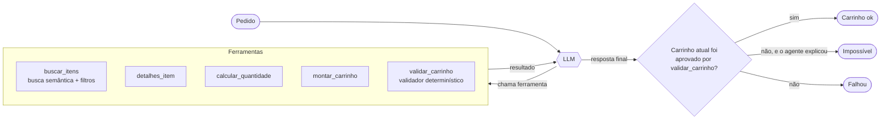
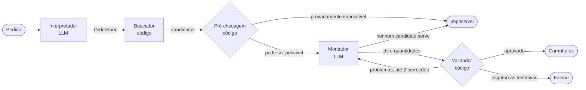

# Montaí

**Montaí: an intent-to-cart AI ordering assistant**

Você escreve um pedido vago, do jeito que falaria ("quero fazer um churrasco para 5 pessoas, até R$ 200"), e o Montaí monta um carrinho de delivery concreto: itens, quantidades, lojas e preço total, respeitando orçamento, número de pessoas e restrições alimentares.

**Demo:** [montai-demo.streamlit.app](https://montai-demo.streamlit.app) (veja [Deploy](#deploy)).

O projeto implementa **duas arquiteturas** para o mesmo problema, um agente único com tool calling e um pipeline com papéis separados, e compara as duas com **avaliação automática**: 45 pedidos de teste com gabarito, métricas calculadas em código e avaliação da busca semântica com recall@5.

---

## O problema

Um pedido como "jantar leve e sem glúten para 2, nada apimentado" é fácil para uma pessoa e difícil para um sistema:

- **Intenção vaga.** Ninguém diz quais categorias quer, quantas unidades, de quais lojas.
- **Restrições duras.** Um item com glúten num pedido "sem glúten" não é um erro pequeno; é o sistema falhando com o cliente.
- **Aritmética.** Quantidade por pessoa, preço total e taxa de entrega de cada loja precisam fechar com o orçamento.
- **Pedidos impossíveis.** "Churrasco para 20 com R$ 50" precisa ser recusado com uma explicação, e não atendido pela metade.

Um LLM resolve bem a primeira parte e mal as outras três. O desenho do Montaí parte disso: **o modelo propõe, o código decide.**

## Princípios

1. **Nenhum item fora do catálogo.** O modelo devolve só ids e quantidades. Nome, preço e total são recalculados a partir do catálogo, e um id inexistente é recusado.
2. **Orçamento e restrições são checados em código.** Um validador determinístico, compartilhado pelas duas versões, julga todo carrinho.
3. **O carrinho final é um objeto Pydantic validado.** Um carrinho inválido nunca sai como "ok": se não houver um carrinho aprovado, o resultado é "impossível" (com o motivo) ou "falhou".
4. **Tudo é rastreado.** Cada etapa registra entrada, saída, tokens, latência e custo estimado. O mesmo trace alimenta o log (JSONL), a interface e a avaliação.

## Arquiteturas

### Versão A: agente único

Um loop em que o modelo escolhe sozinho quais ferramentas chamar e quando parar.



### Versão B: pipeline com papéis separados

Cada etapa tem uma responsabilidade, com entrada e saída tipadas. Só duas usam LLM.



- **Interpretador:** transforma o texto numa especificação (`OrderSpec`) com pessoas, orçamento, restrições, picância máxima, prato pedido e categorias necessárias. Usa structured outputs.
- **Buscador:** para cada categoria, faz busca semântica com as restrições como filtros exatos.
- **Pré-checagem:** prova impossibilidade sem gastar chamadas ao LLM, usando um limite inferior de custo sobre o catálogo inteiro.
- **Montador:** escolhe itens e quantidades a partir de uma tabela de candidatos (com R$/pessoa e a quantidade sugerida).
- **Validador:** o mesmo código da versão A. Os problemas encontrados voltam ao Montador.

## Stack

- **Python 3.11+**, **Pydantic** para todos os contratos de dados.
- **LLM:** `openai/gpt-oss-120b` no **Groq** (plano gratuito), acessado pelo **SDK oficial da OpenAI**. O provedor é configurável (`LLM_BASE_URL`, `LLM_API_KEY`, `LLM_MODEL`): qualquer API compatível com a da OpenAI funciona.
- **Embeddings locais**, sem custo de API: `intfloat/multilingual-e5-small` (sentence-transformers).
- **ChromaDB** como índice vetorial, com filtros por metadados.
- **Streamlit** na interface.
- **Orquestração escrita à mão**, sem LangChain ou LangGraph: o agente cabe num arquivo de ~190 linhas (prompt incluído), e o orquestrador do pipeline em outro de tamanho parecido.

## Como rodar

```bash
python3 -m venv .venv
```

```bash
source .venv/bin/activate
```

```bash
pip install -e ".[dev,ui]"
```

```bash
cp .env.example .env
```

Preencha `LLM_API_KEY` no `.env` com uma chave do Groq ([console.groq.com/keys](https://console.groq.com/keys)). Depois:

```bash
streamlit run app.py
```

Outros comandos:

| O que | Comando |
|---|---|
| Testes (sem rede, sem LLM) | `pytest` |
| Um pedido pelo terminal | `python scripts/run_order.py "jantar vegano para 3, até R$ 100" --version A --trace` |
| Regerar o catálogo | `python scripts/generate_catalog.py` |
| Avaliar a busca (recall@5) | `python scripts/eval_retrieval.py` |
| Avaliar os pedidos | `python scripts/run_eval.py --sample 4 --wait-quota` |
| Só recalcular o relatório | `python scripts/run_eval.py --sample 4 --report-only` |

A interface tem o modo **Exemplos da avaliação**, que mostra execuções reais salvas em `reports/runs/` sem gastar cota.

## Dados

- **Catálogo** ([data/catalog.json](data/catalog.json)): 18 estabelecimentos e 439 itens sintéticos em português (churrascaria, mercado, padaria, japonês, pizzaria, tailandês etc.). Cada item tem preço, porção (`serves`: quantas pessoas uma unidade atende), tags de dieta e nível de picância. Ele é gerado por [scripts/generate_catalog.py](scripts/generate_catalog.py), escrito à mão e sem aleatoriedade, porque as tags de dieta servem de gabarito da avaliação. Testes checam a coerência das tags: um item "vegano" não pode citar queijo.
- **Pedidos de teste** ([data/eval/orders.json](data/eval/orders.json)): 45 pedidos em 5 grupos (ocasiões variadas, orçamento apertado, restrições combinadas, impossíveis e ambíguos), cada um com um gabarito escrito sem olhar a saída do sistema. Um teste prova que os "impossíveis por orçamento" são de fato impossíveis.
- **Gabarito da busca** ([data/eval/retrieval.json](data/eval/retrieval.json)): 15 consultas com os itens relevantes.

## Avaliação

### Métricas por pedido

Todas são calculadas em código, contra o **gabarito** (e não contra o que o sistema entendeu do pedido):

| Métrica | Pergunta |
|---|---|
| Classificação | Entregou carrinho se e só se o pedido era possível? |
| Orçamento | O total recalculado pelo catálogo, com entrega, cabe no orçamento? |
| Restrições | Dieta, "opções" (ex.: uma vegana) e picância respeitadas? |
| Quantidade | A comida principal alimenta todas as pessoas, sem desperdício? |
| Catálogo | Todo id existe, e nome e preço batem com o catálogo? |
| Sucesso | Tudo acima ao mesmo tempo. |

### Busca semântica (15 consultas, k = 5)

| Configuração | recall@5 | MRR |
|---|---|---|
| MiniLM multilíngue | 0,530 | 0,691 |
| MiniLM + dieta e picância no texto | 0,570 | 0,608 |
| **e5-small** | **0,800** | **0,897** |
| e5-small + dieta e picância no texto (usada) | 0,800 | 0,897 |

Detalhes em [reports/retrieval.md](reports/retrieval.md).

### Comparação A × B

Amostra estratificada de **20 pedidos**: 4 sorteados por grupo, com semente fixa (42). A amostra existe por causa do limite gratuito de 200 mil tokens por dia (veja [Limitações](#limitações)). Mesmo modelo nas duas versões: `gpt-oss-120b`.

| | Versão A (agente) | Versão B (pipeline) |
|---|---|---|
| **Pedidos resolvidos por completo** | **90% (18/20)** | **95% (19/20)** |
| Classificou possível/impossível certo | 90% (18/20) | 95% (19/20) |
| Respeitou o orçamento (carrinhos entregues) | 100% (3/3) | 100% (4/4) |
| Respeitou as restrições (carrinhos entregues) | 100% (5/5) | 100% (6/6) |
| Quantidade adequada (carrinhos entregues) | 100% (14/14) | 100% (15/15) |
| Itens existem no catálogo (carrinhos entregues) | 100% (14/14) | 100% (15/15) |
| Tokens por pedido | 8.014 | 4.396 |
| Chamadas ao LLM por pedido | 4,2 | 1,9 |
| Latência líquida, mediana | 4,7 s | 3,2 s |
| Custo estimado por pedido¹ | US$ 0,0014 | US$ 0,0009 |

¹ Preço de referência do modelo num plano pago (US$ 0,15 / 0,60 por milhão de tokens de entrada / saída). No plano gratuito, o custo real foi zero.

| Grupo | A | B |
|---|---|---|
| Ocasiões variadas | 4/4 | 4/4 |
| Orçamento apertado | 2/4 | 3/4 |
| Restrições combinadas | 4/4 | 4/4 |
| Impossíveis | 4/4 | 4/4 |
| Ambíguos | 4/4 | 4/4 |

Relatório completo, com o resultado de cada pedido, em [reports/eval.md](reports/eval.md). As execuções brutas (carrinho e trace completos) estão em [reports/runs/](reports/runs/).

A versão B também foi avaliada nos **45 pedidos** antes de algumas correções (v1): **91% (41/45)** resolvidos, 100% de acerto em orçamento, restrições, quantidade e catálogo nos carrinhos entregues ([reports/history/eval_B_v1.md](reports/history/eval_B_v1.md)).

### Como ler esses números

- **A diferença de acerto entre A e B (um pedido) não é conclusiva** com 20 casos. **A diferença de custo é:** a B gasta cerca de metade dos tokens em todos os grupos, porque o agente reenvia o histórico inteiro a cada turno.
- **Quando entregam um carrinho, as duas versões acertam 100% das regras.** É o efeito do validador em código: o LLM pode escolher mal, mas um carrinho que fura o orçamento ou a dieta não sai.
- **As falhas mostram a fraqueza típica de cada arquitetura:**
  - **A, flexível mas sem garantia de processo.** Num pedido de pizza (t02), o agente fez uma única busca, não viu as pizzas médias mais baratas e declarou o pedido impossível. Em outro (t07), ele escreveu um carrinho em texto sem nunca chamar `montar_carrinho` nem `validar_carrinho`, e a regra "só vale carrinho aprovado em código" barrou a resposta.
  - **B, previsível mas rígida.** No café da manhã para 5 com R$ 80 (t04), o Interpretador marcou "kit de café da manhã" (R$ 189+) como essencial e deixou pães como opcional. O erro se propagou para todas as etapas seguintes. A versão A resolveu esse mesmo caso.

## O que aprendi

1. **"O modelo propõe, o código decide" vale mais que qualquer prompt.** Em execuções reais, o modelo inventou um id (`grafo-003`), contou "20 peças" como 20 pessoas e descreveu um carrinho que nunca montou. Todos esses casos foram barrados pelo validador, e nenhum chegou ao cliente.
2. **Valide mesmo quando o provedor promete garantia.** O "modo estrito" de structured outputs do Groq não restringe a geração: ele valida depois e devolve erro 400 (`json_validate_failed`, `output_parse_failed`). O cliente trata isso devolvendo o erro ao modelo e pedindo de novo.
3. **Carrinho válido não é carrinho bom.** As primeiras versões entregavam churrasco sem carvão e transformavam "uma opção vegana" em tudo vegano por R$ 775. O validador não pegava nada disso, porque era tudo "válido". Alguns problemas pedem regra no prompt, e outros, regra nova no validador (soma das refeições principais).
4. **Pipeline e agente erram de jeitos diferentes.** O pipeline é mais barato e previsível, mas um erro cedo se propaga. O agente se adapta, mas pode explorar pouco e "esquecer" o processo, e reenviar o histórico custa caro. Dados de produção diriam qual erro é mais caro para o negócio.
5. **Na busca, o modelo de embedding importou mais que qualquer ajuste.** O e5 (treinado para busca) bateu o MiniLM por 27 pontos de recall. Dois detalhes que eu não esperava: escrever "não apimentado" em 390 itens piorou a busca (embeddings lidam mal com negação), e atributos estruturados como picância funcionam melhor como **filtro** do que como texto.
6. **O gabarito também precisa de teste.** Um teste encontrou um erro meu: "sushi para 6 com R$ 40" só é impossível se a comida tiver que ser sushi. Sem esse teste, a métrica puniria o sistema por acertar.
7. **Medir certo dá trabalho:**
   - um cache de índice reaproveitava vetores velhos sem avisar;
   - a espera pelo limite de taxa do plano grátis inflava a latência;
   - chamadas presas até o timeout do SDK (10 min) distorciam a média, por isso a medida principal é a mediana da latência líquida.
8. **Cuidado com contaminação.** Cheguei a escrever, como exemplo no prompt, os mesmos pedidos do conjunto de teste, e troquei por exemplos neutros. Toda correção feita olhando falhas do teste infla um pouco a nota (veja abaixo).

## Limitações

- **Dados sintéticos.** O catálogo e os gabaritos foram escritos por mim. Pedidos reais são mais variados e mais ruidosos.
- **Amostra pequena.** A comparação A × B tem 20 pedidos, e cada um vale 5 pontos percentuais.
- **Sem conjunto separado de validação.** Algumas correções da versão B foram feitas olhando falhas do próprio conjunto de teste, e três desses casos (t04, i07, i08) caíram na amostra sorteada, o que favorece um pouco a B. Ela não foi reavaliada nos 45 pedidos depois das correções.
- **Na versão A, o agente informa as restrições ao validador.** Se ele entender o orçamento errado, o validador confere contra o número errado. A avaliação pega isso, porque compara com o gabarito, mas em produção seria um risco.
- **As métricas não medem qualidade subjetiva.** Um churrasco sem carvão conta como sucesso se respeitar orçamento, dieta e quantidade. Isso aconteceu na versão A (o01).
- **Custo estimado incompleto.** Ele usa o preço de referência e não inclui tentativas recusadas pelo provedor, que não informam o uso de tokens.
- **Plano gratuito.** O limite de 200 mil tokens por dia restringe a avaliação (por isso a amostra) e a demo pública (por isso o limite de pedidos por sessão).

## Deploy

A demo roda no **Streamlit Community Cloud** (plano gratuito), publicada a partir da branch `main`:

1. Em [share.streamlit.io](https://share.streamlit.io), crie um app apontando para este repositório, branch `main`, arquivo `app.py`.
2. Em *Advanced settings*, escolha **Python 3.14** (a versão do desenvolvimento; o código usa só recursos de 3.11+, e o `ruff` confere isso).
3. Em *Secrets*, cole o conteúdo de [.streamlit/secrets.toml.example](.streamlit/secrets.toml.example) com a sua chave. Dá para editar depois em *Settings → Secrets*.

Cada push na `main` atualiza a demo. O [requirements.txt](requirements.txt) instala o torch só-CPU no Linux (o pacote padrão traz CUDA e não cabe no plano gratuito). Na primeira visita depois de um deploy, o app baixa o modelo de embeddings e monta o índice, o que leva cerca de um minuto. A demo limita os pedidos por sessão (`MONTAI_MAX_ORDERS_PER_SESSION`, padrão 5), e o modo **Exemplos da avaliação** funciona mesmo sem cota.

### Container (opcional)

O [Dockerfile](Dockerfile) monta uma imagem com torch só-CPU, o modelo de embeddings e o índice já prontos, sem depender do Hub ao subir:

```bash
docker build -t montai .
```

```bash
docker run --rm -p 8501:8501 --env-file .env montai
```

A pasta [space/](space/) tem o README e o script para publicar essa imagem num Hugging Face Space (Docker). Spaces Docker exigem plano pago (PRO), por isso a demo pública fica no Streamlit Cloud.

## Estrutura

```
montai/
├── app.py                     # interface Streamlit
├── data/
│   ├── catalog.json           # catálogo sintético (gerado por script)
│   └── eval/                  # pedidos de teste e gabarito da busca
├── reports/                   # relatórios e execuções brutas da avaliação
├── scripts/                   # gerar catálogo, avaliar, rodar um pedido
├── src/montai/
│   ├── models.py              # contratos Pydantic: item, pedido, carrinho
│   ├── retrieval.py           # embeddings + ChromaDB + filtros
│   ├── validation.py          # validador determinístico (A e B)
│   ├── llm.py                 # cliente LLM: structured outputs, tokens, custo, reenvios
│   ├── tracing.py             # log estruturado por etapa
│   ├── agent_single/          # versão A: ferramentas e loop do agente
│   ├── pipeline/              # versão B: interpretador, buscador, montador, orquestrador
│   └── eval/                  # métricas, recall@k, runner e relatório
└── tests/                     # 74 testes, sem rede (o LLM é roteirizado)
```
